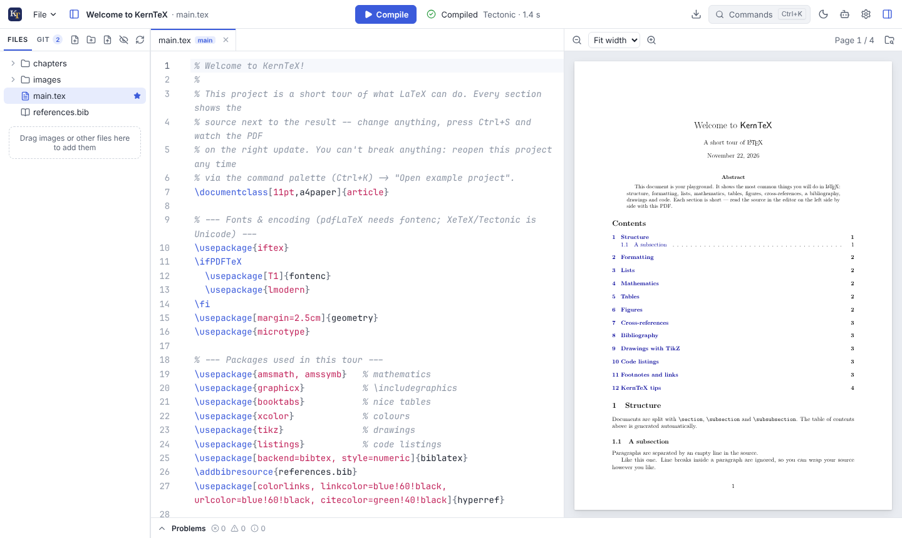
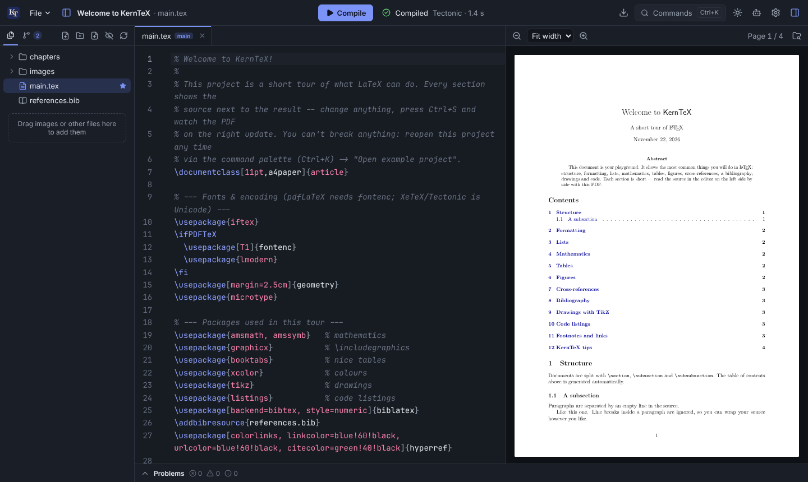

# KernTeX

A fast, modern, local LaTeX editor — file tree, editor and live PDF side by side, with clear error messages and a built-in TeX engine. No account, no cloud, nothing else to install.

<p align="center">
  
  
</p>

## Quickstart

1. **Download** the installer for your system from the [Releases page](https://github.com/nicolasasauer/kerntex/releases) (Windows `.exe`/`.msi`, Linux `.AppImage`/`.deb`).
2. **Open KernTeX.** The first start opens a compiled example project that tours LaTeX.
3. **Click “New project”** — or drag a project folder or an Overleaf ZIP onto the window.

No TeX installation needed: KernTeX ships with [Tectonic](https://tectonic-typesetting.github.io), which downloads the LaTeX packages your document uses automatically (the very first compile needs an internet connection).

> **Windows SmartScreen:** the installer isn't code-signed yet, so Windows may show “Windows protected your PC”. Click **More info → Run anyway**.

## Features

- **Overleaf-style layout** — file tree, editor with tabs, PDF preview, collapsible problems panel; all panels resizable.
- **Save = compile** — `Ctrl+S` saves and compiles (can be turned off); optional autosave; compiling shows its live progress (“Typesetting (pass 2)”, “Downloading packages – amsmath.sty”) and can be stopped.
- **Errors you can act on** — every problem says where it came from (LaTeX, a package, BibTeX/Biber, Tectonic, latexmk, the file system), its file and line (click to jump) and how to fix it in plain language. The raw log is one click away.
- **Missing packages** — the editor notices when you use `\includegraphics`, `\toprule`, `\SI` … without loading the package and offers a one-click fix. Hover `\usepackage{…}` to see what a package does.
- **Smart completion** — commands, environments, `\ref{` with all labels of the project and `\cite{` with all keys from your `.bib` files.
- **Command palette** (`Ctrl+K`) with every action and its shortcut.
- **Light and dark mode**, following your system by default. Respects “reduce motion”.
- **Images in two clicks** — drag files onto the file tree (or *Add files…*), preview images and PDF figures, insert a ready-made `figure` with one click.
- **Look under the hood** — *Build details* shows the engine and its version, the document class and every package with its version, plus links to the output folder and the full log. No log flood: it's there when you open it.
- **Safe with your files** — atomic saves, autosave, deleting goes to the system trash, nothing is overwritten without asking. Build output lives in `.kerntex/out/`, keeping your folder clean.

## Bring your Overleaf projects

KernTeX works on ordinary folders — there's no special project format.

- **From Overleaf:** *Menu → Download → Source*, then drop the ZIP on KernTeX (or *Import ZIP*). The main file is detected automatically (`% !TEX root` and `% !TEX program` are respected).
- **Back to Overleaf:** *Export project as ZIP* and upload it as a new project.
- **For arXiv and journals:** *Export clean ZIP* leaves out auxiliary files but keeps the `.bbl`.

Per-project choices (main file, engine) are stored in `.kerntex/project.json` — commit it so they travel with the project via Git. Build output in `.kerntex/out/` is git-ignored in new projects.

## Use your own TeX distribution

Prefer TeX Live or MiKTeX? Open **Settings → Default engine → latexmk** and pick pdfLaTeX, XeLaTeX or LuaLaTeX — or set it per project. Projects with a `latexmkrc` use latexmk automatically. If a package is missing, KernTeX shows the `tlmgr install …` command, a MiKTeX hint, or offers to switch that project to Tectonic.

## Build from source

Requirements: [Node.js 22+](https://nodejs.org), [Rust (stable)](https://rustup.rs) and the Tauri prerequisites for your OS:

- **Windows:** Microsoft C++ Build Tools and WebView2 (preinstalled on Windows 10/11).
- **Linux (Debian/Ubuntu):** `sudo apt install libwebkit2gtk-4.1-dev libgtk-3-dev librsvg2-dev libayatana-appindicator3-dev build-essential`

```sh
npm install
npm run setup:tectonic   # downloads Tectonic into src-tauri/binaries/
npm run tauri dev        # run the app with hot reload
npm run tauri build -- --config src-tauri/tauri.tectonic.conf.json   # installers with bundled Tectonic
```

`npm run dev` alone starts the UI in a normal browser with a mock backend — handy for working on the interface.

## Contributing

Issues and pull requests are welcome — see [CONTRIBUTING.md](CONTRIBUTING.md) and the UX rules in [DESIGN.md](DESIGN.md). A planned MCP interface for AI agents is described in [docs/mcp.md](docs/mcp.md); open points are tracked in [docs/roadmap.md](docs/roadmap.md).

## License

[MIT](LICENSE) © Nicolas Sauer. Tectonic is distributed under its own [MIT license](https://github.com/tectonic-typesetting/tectonic/blob/master/LICENSE).
