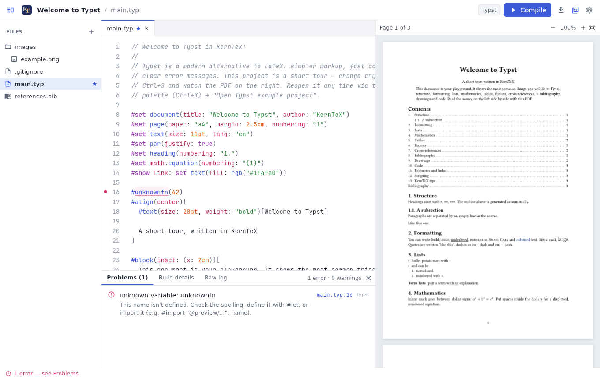

# KernTeX — Flutter UI (preview)

An alternative front end for KernTeX, written in Flutter, on **the same Rust
core** as the Tauri desktop app. It exists to answer a concrete question with
numbers instead of opinions: *is Flutter leaner or faster than Tauri for
KernTeX?* (Results [below](#measurements).)



Nothing in `src-tauri/src/core` was changed for it; both apps compile the very
same files.

## How it fits together

```
flutter/
├── lib/                Dart UI (no state-management or editor packages)
│   ├── main.dart
│   └── src/
│       ├── native.dart        FFI bindings + two worker isolates (build, render)
│       ├── state.dart         one ChangeNotifier: project, tabs, build, settings
│       ├── editor/            self-built code editor (highlighting, gutter, marks)
│       ├── pdf_view.dart      preview: pages rasterised by Rust, on-demand
│       ├── workspace.dart     toolbar, file tree, tabs, problems, status bar
│       ├── start_screen.dart  and dialogs.dart, theme.dart
├── native/             Rust cdylib: a ~250-line C ABI over src-tauri/src/core
└── hook/build.dart     Dart build hook: runs cargo, bundles the library
```

* **No code generator.** The bridge is four C functions: `kt_call(method, json)`
  returns `{"ok": …}` or `{"err": AppError}`; `kt_cancel` and `kt_progress` are
  cheap and callable while a build runs; `kt_pdf_render` returns an RGBA buffer.
  The JSON is exactly what the Tauri commands exchange, so both UIs speak the
  same protocol.
* **No CMake glue.** `hook/build.dart` is a Dart build hook: `flutter run` and
  `flutter build` compile the Rust crate with cargo for the target platform and
  bundle `kerntex_native` automatically (Linux, Windows; macOS/Android targets are
  mapped but untested).
* **The UI thread never blocks.** Two long-lived isolates call into Rust: one
  for builds and file-system work, one for PDF pages, so a running build never
  stalls scrolling.
* **PDF without a PDF engine in the UI.** Pages are rasterised in Rust by
  [hayro](https://github.com/LaurenzV/hayro) at exactly the on-screen
  resolution. hayro is already part of Typst's dependency tree, so this adds
  no code to the binary. One page renders at a time, the visible page first;
  only ~10 bitmaps stay in memory.
* **Self-built editor.** `EditableText` with a fixed line height, so the gutter,
  the active line and "jump to line" are plain arithmetic; the gutter paints
  only visible line numbers. LaTeX, Typst and BibTeX highlighting is one linear
  pass per edit. Diagnostics are underlined at the exact column (Typst) or line
  (TeX). Tab/Shift+Tab indent, Enter keeps indentation, Ctrl+/ toggles
  comments, undo/redo is built in.

Dependencies beyond Flutter itself: `ffi`, `file_selector` (native file
dialogs), `hooks`/`code_assets` (the build hook) — all published by the Dart and
Flutter teams.

## Run it

Needs Flutter 3.50+ and Rust (stable). On Linux also `ninja-build libgtk-3-dev clang cmake pkg-config`.

```sh
cd flutter
flutter run -d linux        # or: -d windows
flutter build linux --release
```

The first build compiles the Rust core with LTO and takes a few minutes.
Tectonic is found like in the Tauri app: `KERNTEX_TECTONIC`, then next to the
executable, then `PATH`; without it, LaTeX projects use latexmk. Typst needs
nothing.

Checks: `flutter analyze`, `flutter test`, and in `native/`
`cargo clippy --all-targets -- -D warnings` and `cargo test`. CI:
`.github/workflows/flutter.yml` builds Linux and Windows bundles (with
Tectonic) and uploads them as artifacts.

## What works

Start screen (new project from all LaTeX and Typst templates, open folder,
import Overleaf ZIP, LaTeX example, Typst tour, recent projects) · file tree
(new file/folder, add files, rename, trash, set main file, reveal) · tabs with
unsaved markers · editor as above · compile with progress and Stop (Tectonic,
latexmk, built-in Typst) · Problems with hints and jump-to-source · Build
details (engine, document class, packages) · raw log (virtualised) · PDF
preview with zoom (buttons, Ctrl+wheel) and page indicator · image and PDF file
previews · export PDF · settings (theme, font size, compile on save, engines) ·
About · light and dark theme · keyboard shortcuts as in the Tauri app.

Not (yet) ported: command palette, autocomplete, find/replace, SyncTeX-free
"jump from PDF", drag & drop from the file manager, export ZIP, the
missing-package card with one-click fixes.

## Measurements

Same machine, same document (the Typst tour, compiled, first PDF page
visible), Linux, software rendering (Xvfb, no GPU), Rust core built with the same
release profile. Memory is **PSS** (shared pages split fairly) summed over all
of the app's processes, measured 10 s after start.

| | Tauri (WebKitGTK) | Flutter |
|---|---|---|
| Processes | 3 (app, WebKit web, WebKit network) | 1 |
| Memory, fresh start | **377 MB** (98 + 258 + 21) | **312 MB** |
| Memory after the LaTeX example, then the Typst tour | 636 MB in the WebKit web process alone | 342 MB |
| Typst rebuild after an edit | ~0.0–0.1 s | ~0.0–0.1 s (same core) |
| Linux download (without Tectonic) | 20.5 MB `.deb` (uses the system's WebKitGTK) | 28.5 MB `.tar.gz` (61 MB unpacked, engine included) |

Of Flutter's 312 MB, about 46 MB is the software OpenGL stack (llvmpipe,
`libLLVM`) that a real GPU driver replaces; the Rust core (Typst fonts and
caches) is the same in both apps.

**Reading the numbers:** Flutter uses roughly 15–20 % less memory on a fresh
start, and it stays flat when you switch projects, whereas WebKit's web
process grows. Compile speed is identical because both apps run the same Rust
code. Where they differ is the install size: Tauri borrows the system web
view, while Flutter ships its own engine, which makes the Flutter download
larger: about 8 MB more on Linux. On Windows the gap should be similar
(Tauri's v0.1.3 installer was 15–23 MB before Typst); the CI artifacts show the
Flutter size.

The editor is the trade-off. CodeMirror (Tauri) virtualises the document and
has a mature ecosystem: autocomplete, search and bracket matching come with it.
The Flutter editor here is self-built and lays out the whole file on each edit,
which is fine for typical documents (thousands of lines) but would need
viewport-based rendering for very large ones.
